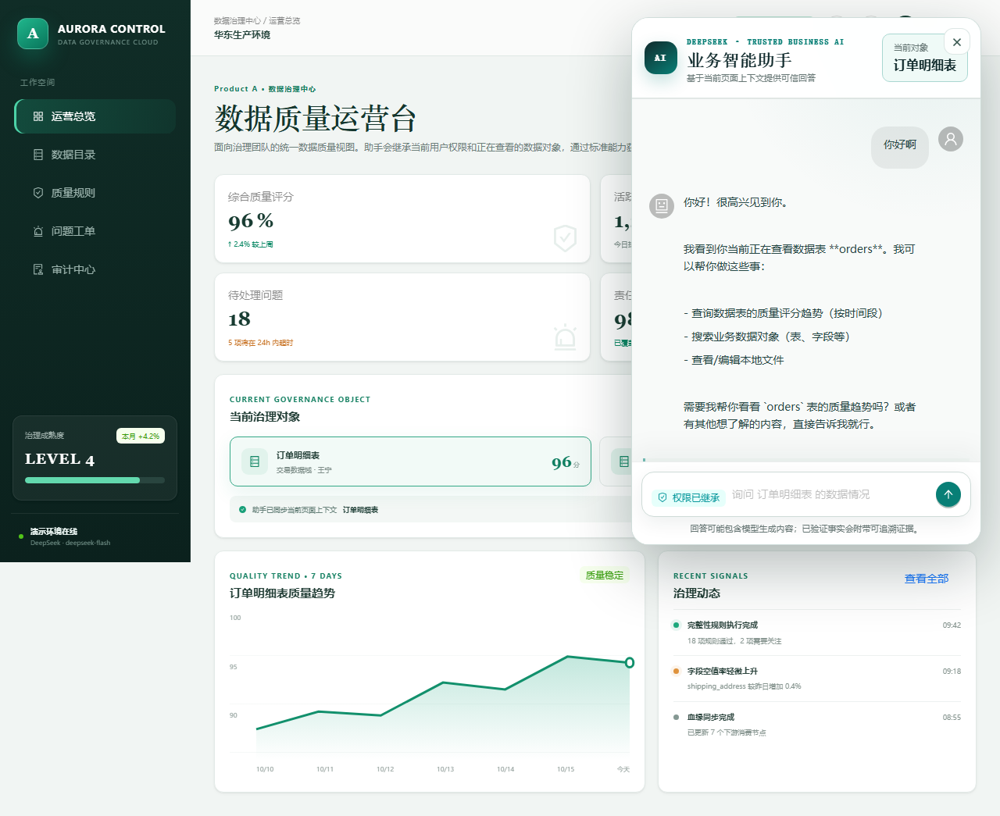
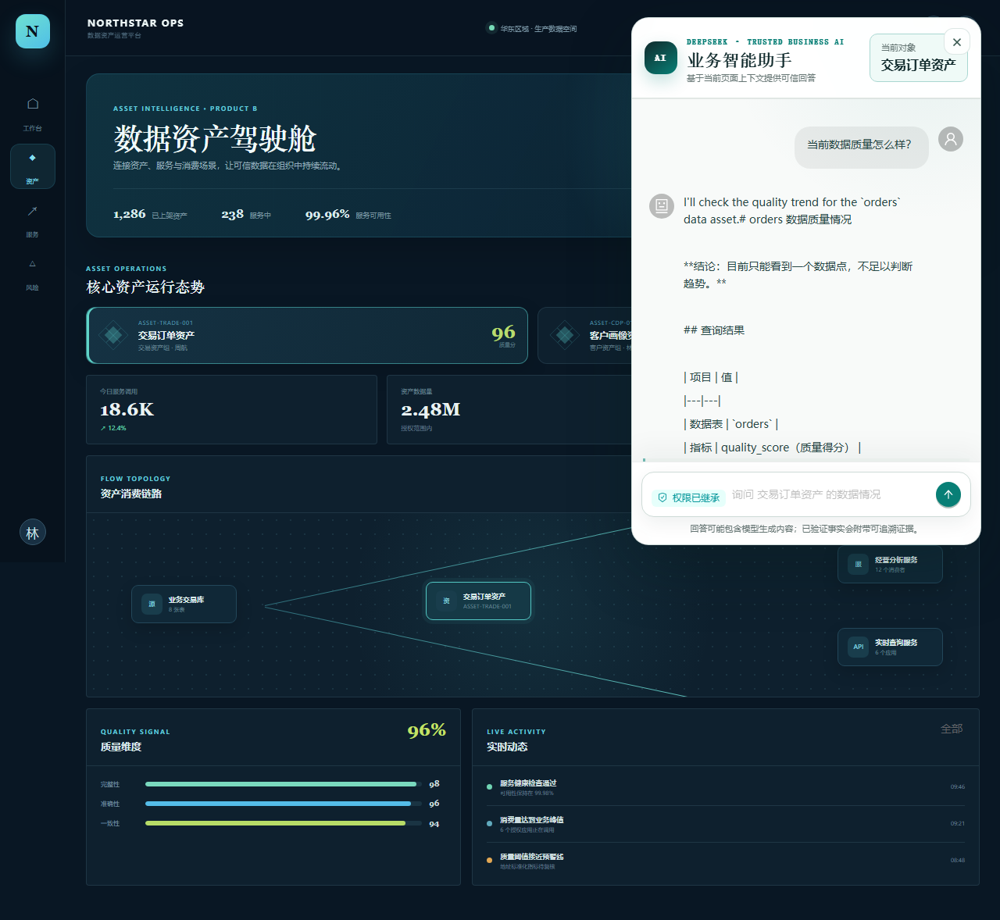

# Deep Agents AI Assistant

面向企业业务系统的通用 AI 智能助手集成框架。项目直接使用官方 Deep Agents TypeScript SDK 作为 Agent Harness，通过标准 Capability Contract、可信业务 Adapter、服务端权限继承、页面 ContextSnapshot 和 Evidence 追溯，把同一套助手能力安全地接入不同企业产品。

项目不是 OpenClaw 的重新实现，也不自研 Agent Loop、任务规划器或 LangGraph Checkpointer。不同产品使用同一份代码独立部署，Agent 只感知标准业务能力，不感知 Product A、B、C 的具体接口。

## 当前进度

V2.0 的 M0～M5 已完成本地工程与离线系统验收：

- M0：pnpm Monorepo、TypeScript、质量工具以及 Deep Agents Tool、Skills、Subagents、Backend、Checkpointer、Runtime Context 和 Streaming 验证。
- M1：Plugin SDK、可信 Plugin Loader、Capability Registry/Executor，以及 Product A/B 双 Adapter 自动挂载。
- M2：身份、ContextSnapshot、Session、Run、REST/SSE、Evidence 解引用、审计和取消闭环。
- M3：React 独立 Web、共享 Chat Core、受控 View Renderer、证据面板和管理状态查询。
- M4：React SDK、JavaScript SDK、跨 Origin iframe，以及一次性票据换取短期凭证。
- M5：A/B 独立部署配置、双实例 TCP 验收、标准契约一致性、安全/E2E、升级回滚和可观测性说明。

当前业务 API、Identity Provider 和持久化存储仍是 Mock/内存实现。工程验收通过不等同于生产上线；详细边界见 [M5 验收报告](docs/m5-acceptance-report.md)和 [实施状态](docs/implementation-status.md)。

## 核心原则

- 标准契约：Agent 只调用平台维护的 Capability，不直接依赖产品私有 API。
- 权限继承：身份、功能权限、对象/行列权限和脱敏由服务端及原业务系统强制执行。
- 页面感知：宿主页面 Context 先经服务端归一化，每个 Run 固定一个 Snapshot。
- 插件扩展：可信 Adapter 在启动时发现、校验、注册并转换为 Deep Agents Tools。
- 可信结果：业务结果携带来源、范围、时间、统计口径和 Evidence 引用；数据不足明确返回 `partial` 或标准错误。
- 独立部署：A/B/C 不共享会话、模型配置、凭证、存储或 Checkpointer，不建设集中式动态产品路由。

## 目录结构

```text
Deep-Agents-AI-Assistant/
├─ adapters/                         # 具体产品的业务 API → 标准 Capability 映射
│  ├─ demo-product-a/                # Product A 示例插件及契约测试
│  └─ demo-product-b/                # Product B 示例插件及契约测试
├─ apps/
│  ├─ agent-server/                  # Agent Server、REST/SSE、会话、Context、Evidence
│  │  ├─ migrations/                 # 持久化模型参考迁移
│  │  └─ src/m2/                     # 企业可信执行闭环
│  ├─ assistant-web/                 # 独立 React Web
│  └─ assistant-embed/               # iframe 内运行的助手页面
├─ core/
│  ├─ capability/                    # 标准契约、Catalog、Registry、Executor
│  ├─ context/                       # Host Context、Normalized Context、Snapshot 契约
│  ├─ evidence/                      # Evidence 安全解析与返回模型
│  └─ policy/                        # 服务端 Capability 授权策略
├─ packages/
│  ├─ agent-runtime/                 # Deep Agents 薄封装与动态 Tool Factory
│  ├─ assistant-sdk/                 # React Hook/组件和原生 JavaScript SDK
│  ├─ assistant-transport/           # 版本化 REST/SSE 客户端与断流续传
│  ├─ assistant-ui/                  # 独立 Web 与嵌入 Shell 共用的 Chat Core
│  ├─ contracts/                     # Assistant API、事件和 View 公共契约
│  ├─ iframe-bridge/                 # 跨 Origin 消息协议与校验
│  ├─ plugin-runtime/                # 插件发现、校验、加载、生命周期和 Driver
│  └─ plugin-sdk/                    # definePlugin/implementCapability 开发 API
├─ demo/                             # 所有可执行演示工程，和正式模块隔离
│  ├─ product-a/                     # React + Ant Design 数据治理接入演示
│  ├─ product-b/                     # Vue 3 + Element Plus 数据资产接入演示
│  ├─ product-shell/                 # Product A React 业务壳和助手接入层
│  ├─ sdk-host/                      # React/JS/iframe 三种接入方式演示宿主
│  ├─ server/                        # M3/M4/A/B 离线 Demo Server 入口
│  ├─ scripts/                       # 双产品一键启动与进程清理
│  └─ README.md                      # 演示目录边界和运行说明
├─ deployments/
│  ├─ product-a/.env.example         # A 实例独立部署样例
│  ├─ product-b/.env.example         # B 实例独立部署样例
│  └─ README.md                      # 部署、升级、回滚和可观测性说明
├─ docs/
│  ├─ architecture-v2.0/             # 唯一架构设计基线和 M0～M5 阶段规范
│  ├─ implementation-status.md       # 当前真实实施状态与生产边界
│  └─ m0-acceptance-report.md ...    # 各阶段真实验收记录
├─ skills/poc-data-quality/          # Deep Agents FilesystemBackend Skill 样例
├─ tests/capability-contract-testkit/ # Adapter 共享契约测试工具
├─ .env.example                      # 本地模型与 Agent Server 配置模板
├─ AGENTS.md                         # 仓库开发规则和架构约束
├─ pnpm-workspace.yaml               # pnpm Workspace 与依赖版本目录
└─ package.json                      # 根级开发、检查、测试和构建命令
```

`node_modules/`、构建产物、测试输出、本地 `.env` 和本地参考源码目录不属于正式工程结构，不应提交。

依赖方向遵循 `core → plugin-sdk/runtime → agent-runtime/server → UI/SDK`；Adapter 依赖标准契约和 Plugin SDK，Agent 核心不得依赖具体产品 Adapter。

### 前端页面与助手代码定位

前端采用“一个 Shared Chat Core、两个 Assistant Shell、多个业务宿主”的结构。需要调整页面时，先根据下表定位所属层级，避免在 Product A、Product B、iframe 和独立 Web 中重复实现聊天逻辑。

| 页面或模块 | 入口与主要文件 | 职责 |
| --- | --- | --- |
| 独立 Web | `apps/assistant-web/src/main.tsx`、`App.tsx`、`app.css` | 完整的独立访问页面，包含助手、会话管理、运行状态和本地模拟身份切换；开发入口为 `http://127.0.0.1:5173` |
| iframe 助手页面 | `apps/assistant-embed/src/main.tsx`、`styles.css` | 真正运行在 iframe 内的 Assistant Shell；负责一次性票据交换、短期凭证和宿主 Context 接收，不包含 Product A/B 业务页面 |
| 声明式 iframe Loader | `apps/assistant-embed/src/host-loader.ts`、`packages/iframe-bridge/src/host-loader.ts` | 生成稳定的 `assistant-loader.js`；在 Shadow DOM 中统一创建右下角按钮、固定浮窗和 iframe，业务工程不再实现助手容器或样式 |
| Shared Chat Core | `packages/assistant-ui/src/ChatWorkspace.tsx`、`MessageList.tsx`、`ChatComposer.tsx`、`ExecutionTimeline.tsx`、`EvidencePanel.tsx`、`styles.css` | 独立 Web、React/JavaScript SDK 和 iframe 共用的聊天、流式进度、受控 View 与 Evidence UI；通用对话样式优先在这里修改 |
| React / JavaScript SDK | `packages/assistant-sdk/src/index.tsx`、`react.tsx`、`controller.ts`、`styles.css` | 提供 `AssistantReact`、React Provider/Hook 和 `createAssistant()`；控制 inline、floating、modal 等挂载形式与打开/关闭状态 |
| iframe 通信 | `packages/iframe-bridge/src/index.ts` | 校验 Origin、Window Source 和 channelId，传递一次性 Ticket 与页面 Context；与 Loader 共同维护安全宿主边界 |
| REST / SSE 客户端 | `packages/assistant-transport/src/index.ts` | 所有前端共用的 Session、Run、ContextSnapshot、Evidence 和 SSE 事件客户端 |
| Product A 页面 | `demo/product-a/index.html`、`src/main.tsx`；共享业务壳位于 `demo/product-shell/src/index.tsx`、`styles.css` | React + Ant Design 数据治理宿主页；入口 HTML 只声明 Loader、iframe 地址和初始 Context，不包含助手按钮、浮窗或 iframe 模板 |
| Product B 页面 | `demo/product-b/index.html`、`src/App.vue`、`main.ts`、`styles.css` | Vue 3 + Element Plus 数据资产宿主页；同样只在入口 HTML 声明 Loader 配置，不独立实现助手 UI |
| SDK 三方式实验页 | `demo/sdk-host/src/main.tsx`、`styles.css` | 对比 React SDK、JavaScript SDK、跨域 iframe 三种挂载方式，主要用于 M4 回归验证 |

两条主要渲染链路如下：

```text
独立 Web：
apps/assistant-web
  → packages/assistant-ui
  → packages/assistant-transport
  → apps/agent-server

业务系统 iframe 接入：
demo/product-a 或 demo/product-b 的 index.html（声明 iframe 地址）
  → assistant-loader.js（Shadow DOM 按钮、固定浮窗、iframe）
  → packages/iframe-bridge
  → apps/assistant-embed（iframe 内助手页面）
  → packages/assistant-sdk
  → packages/assistant-ui
  → packages/assistant-transport
  → 各产品独立 Agent Server
```

常见修改位置：

- 修改聊天消息、输入框、执行进度或 Evidence 展示：改 `packages/assistant-ui/src/`。
- 修改通用 SDK 浮窗、启动按钮和挂载行为：改 `packages/assistant-sdk/src/`。
- 修改统一的 iframe 启动按钮、固定浮窗、初始化或短期凭证交换：改 `packages/iframe-bridge/src/host-loader.ts` 和 `apps/assistant-embed/src/host-loader.ts`，不要在产品工程中复制。
- 修改 Product A 的业务页面：改 `demo/product-shell/src/`；品牌和业务样例配置在 `demo/product-a/src/main.tsx`，助手接入配置在 `demo/product-a/index.html`。
- 修改 Product B 的业务页面：改 `demo/product-b/src/App.vue` 和 `styles.css`，助手接入配置在 `demo/product-b/index.html`。
- 修改独立访问页面的导航、会话页或运行状态页：改 `apps/assistant-web/src/App.tsx` 和 `app.css`。

独立 Web 需要同时启动 Agent Server 和 Web 页面：

```bash
pnpm dev:server   # http://127.0.0.1:3000
pnpm dev:web      # http://127.0.0.1:5173
```

Product A/B 的 iframe 悬浮助手演示使用：

```bash
pnpm demo         # Product A: 5411；Product B: 5412
```

业务工程的最小声明式接入如下。`assistant-loader.js` 由助手发行物提供，悬浮按钮、窗口尺寸、层级、响应式样式和 iframe 生命周期均由 Loader 管理：

```html
<script id="enterprise-assistant-context" type="application/json">
  {
    "page": { "type": "asset-detail", "route": "/assets/orders" },
    "object": { "type": "data_table", "rawId": "orders", "name": "订单表" }
  }
</script>
<script
  type="module"
  src="https://assistant.example.com/assistant-loader.js"
  data-enterprise-assistant
  data-iframe-url="https://assistant.example.com/"
  data-ticket-endpoint="/api/v1/embed/tickets"
  data-context-element="enterprise-assistant-context"
></script>
```

生产环境的 `data-ticket-endpoint` 应由宿主后端基于当前登录态签发一次性 Ticket；长期 Token、模型 Key 和业务凭证不得写入 HTML。页面内业务对象变化时可派发 `enterprise-assistant:context` 自定义事件，Loader 会校验并把新 Context 传给下一次提问，进行中的 Run 仍使用原 Snapshot。Demo 中的 `data-demo-access-token` 仅允许 localhost，不能用于生产。

## 环境要求与质量门禁

- Node.js 22+
- pnpm 10.32.1
- 可选：DeepSeek 或 OpenAI 兼容模型 API Key，仅真实模型烟测/服务需要

```bash
pnpm install --frozen-lockfile
pnpm lint
pnpm typecheck
pnpm test
pnpm build
pnpm format:check
```

离线测试使用 LangChain 官方 Fake Model，但仍会真实运行 Agent 图、Tools、Plugin Loader、Subagent、MemorySaver 和 Streaming。当前全量门禁包含 75 个 Vitest 测试，另有 10 个 Chromium E2E 用例；数量以后续代码和验收报告为准。

## 查看页面效果

### 双产品业务接入演示（推荐）

先在根目录 `.env` 配置 `DEEPSEEK_API_KEY`，再用一条命令同时启动 Product A、Product B、各自独立的 Agent Server 和 iframe 助手：

```bash
pnpm demo
```

- Product A 数据质量运营台（React 19 + Ant Design 6）：`http://127.0.0.1:5411`
- Product B 数据资产驾驶舱（Vue 3 + Element Plus + Vite）：`http://127.0.0.1:5412`

两套页面采用不同宿主框架和视觉语言，但都通过安全 iframe Bridge 挂载同一套 Assistant SDK 和标准 Capability，分别连接 `demo-product-a`、`demo-product-b` Adapter；端口、进程、会话与 Checkpointer 独立。助手头部和输入区固定，中间消息区独立滚动。完整讲解顺序和边界见 [双产品演示指南](docs/dual-product-demo-guide.md)。

交互式演示只使用真实 DeepSeek，页面显示 `LIVE DEEPSEEK` 和实际模型名称；缺少 Key 时服务端会明确启动失败，不提供离线回退。自动化测试使用隔离的 LangChain Test Double，不属于可启动的演示模式。





历史 M3 独立 Web 与 M4 三接入方式的自动化验证仍作为回归测试保留，不作为当前交互式演示入口。浏览器回归命令：

```bash
pnpm --filter @assistant/assistant-web e2e
pnpm --filter @assistant/demo-host e2e
```

## 使用真实模型

从根目录 `.env.example` 创建本地 `.env`，填写自己的配置，不要提交该文件：

```dotenv
DEEPSEEK_API_KEY=
DEEPSEEK_BASE_URL=https://api.deepseek.com
MODEL_NAME=deepseek-chat
```

执行真实 DeepSeek Tool Calling 烟测：

```bash
pnpm --filter @assistant/agent-server smoke:deepseek
```

启动真实模型 Agent Server：

```bash
pnpm dev:server
```

## 插件与独立部署

插件入口只允许从已批准的安装目录加载，并校验 Manifest、入口路径、协议版本、Capability 声明和构建产物哈希。开发样例位于 `adapters/demo-product-a` 与 `adapters/demo-product-b`。

A/B 独立部署样例、密钥边界、启动探针、升级和回滚步骤见 [deployments/README.md](deployments/README.md)。生产环境必须替换 Mock Identity、模拟业务 API、内存 Repository 和 `MemorySaver`，并配置独立密钥、持久化 Checkpointer、TLS、严格 CSP、Origin 白名单、指标告警与灾备恢复。

## 文档入口

- [架构文档索引](docs/architecture-v2.0/00-README.md)
- [架构基线与边界](docs/architecture-v2.0/01-架构基线与边界.md)
- [工程结构与依赖规则](docs/architecture-v2.0/03-工程结构与依赖规则.md)
- [安全、权限、证据与审计](docs/architecture-v2.0/08-安全权限证据与审计.md)
- [测试体系与质量门禁](docs/architecture-v2.0/16-测试体系与质量门禁.md)
- [架构决策记录](docs/architecture-v2.0/18-架构决策记录.md)
- [M5 验收报告](docs/m5-acceptance-report.md)
- [双产品演示指南](docs/dual-product-demo-guide.md)

## 安全提示

不要提交 `.env`、模型密钥、长期业务 Token、真实敏感数据或完整业务响应。Prompt、页面 Context 和前端 UI 都不是授权依据；最终权限与脱敏必须由服务端和原业务 API 执行。
