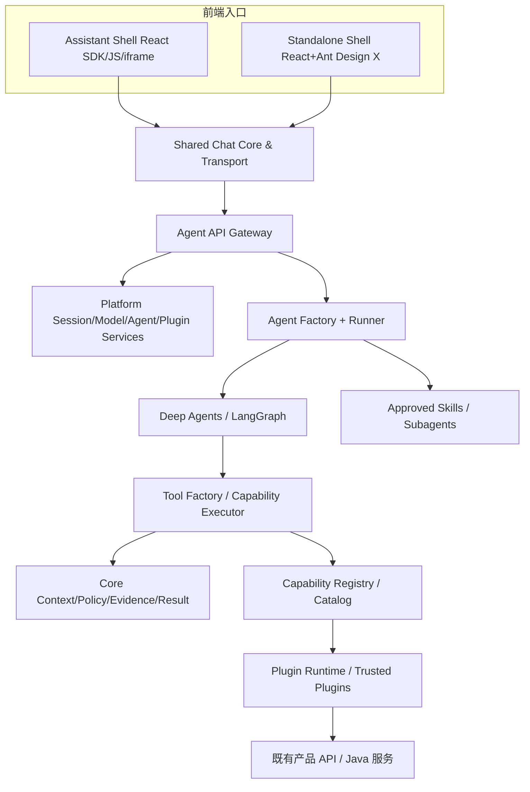

# 01 · 总体架构基线与边界

## 1. 产品目标

面向数据治理等企业业务系统的通用 AI 智能助手，提供自然语言查询、汇总对比、趋势/异常分析、页面与业务对象上下文、多轮对话、依据可追溯、权限继承、领域知识与专业任务委派，并支持对已有服务建设/治理提出建议与草稿。

**复用边界**：同一软件发行版可以用于产品 A、产品 B 或未来 C，但每套环境独立部署自己的 Agent Server、前端入口、模型配置、Session/Checkpoint、插件集合、业务凭证与 API。**绝不需要跨产品会话连续性。**

## 2. 非目标

- 不自研 Agent 推理循环、计划调度器或 LangGraph Runtime。
- 不创建一个可以跨 A/B/C 运行时切换的集中式产品路由中心。
- 不维护跨实例会话迁移、统一登录或统一模型配置中心。
- 不允许浏览器端直接调用大模型服务密钥。
- 不为每个产品复制一套聊天 UI。
- V1.0 不开发完整插件市场、热加载、任意代码上传执行、多租户复杂治理、自动数据写入/删除或长期后台 Agent 任务编排。

## 3. 技术选型

| 层 | 基线选型 | 说明 |
|---|---|---|
| Web | React + TypeScript | 两种 Web 模式共享业务组件 |
| AI UI | Ant Design X；Ant Design 基础组件 | Chat UI/会话/进度与后台管理 |
| Web SDK | React / Vanilla JS / iframe | 不暴露 Harness 内部协议 |
| 服务端 | Node.js + TypeScript | Agent API、配置、会话、权限、插件加载 |
| Harness | LangChain Deep Agents (`deepagents`) | 通过 `createDeepAgent` 装配，版本以 M0 锁定 |
| Runtime | LangGraph | 通过 Deep Agents 使用 Stream/Checkpointer |
| 插件 | 平台自研 Plugin SDK + Runtime | 本地可信包自动发现；HTTP 业务接口；MCP 后续 |
| 核心能力 | Core / Capability Catalog | 稳定 Schema、执行与证据 |
| 业务后端 | 原有 Java/其他服务 | 保持现有 API 和数据模型；由 Adapter 归一化 |
| 存储 | 首先可用的关系数据库 + Checkpointer | 具体驱动在 M2 实测决定 |

## 4. 逻辑拓扑

图是**逻辑依赖**。`Plugin Runtime` 和 `Capability Executor` 可以与 `Agent Server` 同进程；不能将这些盒子误读为必须部署的微服务。

## 5. 运行时生命周期分离

1. **部署/启动**：准备模型配置、安装可信插件；扫描 Manifest；验证兼容性；初始化插件；注册标准能力；建立健康状态。
2. **装配**：Agent Factory 根据配置选择模型、已启用 Capability、Skills、Subagents、Backend 与 Checkpointer；构建可缓存 Agent。
3. **请求/Run**：认证用户、建立 ContextSnapshot、限定 Agent/Tool 权限；Runner 启动 Run；Deep Agents 根据任务调用 Tool；执行器再做强制鉴权、校验、审计。
4. **响应**：Deep Agents 原生事件经 Event Bridge 转为稳定的 SSE 事件；共享 UI 呈现文本、阶段、图表、证据。
5. **结束/恢复**：保存 Session 元数据、Run 记录、Checkpoint 与事件日志；允许断线重连及同一实例内继续对话。

## 6. 三个稳定边界

### 6.1 产品差异边界

Agent 只看到标准业务对象/工具，如 `data_quality.get_trend`；插件内部完成现有 API 参数、认证转发和结果转换。**无插件不应自动创造相应工具**；不同产品缺少的数据要报 `UNSUPPORTED` 或 `PARTIAL_DATA`，不能补造。

### 6.2 运行与业务边界

Deep Agents 决定何时用工具、是否委派 Subagent；Core 决定该工具是否可执行、如何验证数据、如何追溯；业务 API 决定用户实际可以获取哪些对象、行、列。中间件只能辅助，不替代工具/业务 API 强制鉴权。

### 6.3 Web 双模式边界

助手模式仅改变宿主挂载/上下文收集方式；独立 Web 包含聊天和管理菜单；两者使用一个 ChatWorkspace、同一事件协议。iframe 使用 Bridge 安全通信，不复制聊天系统。

## 7. 首版重点能力与阶段

- **M0**：框架和 Monorepo 验证；Deep Agents 最小 Invoke/Stream/Thread。
- **M1**：Plugin SDK / Loader / Capability Registry / Tool Factory / 模拟 A/B 插件。
- **M2**：真实 Agent API、Session/Run/Model、ContextSnapshot、Policy、Evidence、SSE。
- **M3**：Shared Chat Core + 独立 Web + 必要管理页。
- **M4**：React SDK/JS SDK/iframe 集成、宿主上下文与样式隔离。
- **M5**：两套独立部署、端到端、安全、回归与文档交付。

## 8. 验收架构成立的四条硬标准

1. 删除 A 适配器、仅安装 B 适配器并重启，**不修改 Agent Factory、Tool Factory、React UI**，仍能调用相同标准能力。
2. 原始返回字段不同，但同一标准 Capability 的输入/输出 Schema 完全一致；超出产品支持范围的请求明确拒绝/部分成功。
3. 篡改宿主上下文和伪造 `userId`、`tenantId`、`threadId` 不会获得越权结果；业务 API 始终做最终数据授权。
4. 同一部署实例内的独立 Web 和嵌入式助手复用 Chat Core；**不同部署实例之间不传递会话数据**。

## 9. 官方能力与自主能力表

| 模块 | 来源 | 状态 |
|---|---|---|
| `createDeepAgent`, LangChain Tools, Subagents, Skills Middleware, Backend | Deep Agents 官方 | M0 验证安装版本 |
| LangGraph Streaming, Checkpoint | 官方依赖 | M0/M2 验证 |
| `definePlugin`, `implementCapability`, Plugin Loader | 平台自研 | M1 实现 |
| Capability Catalog/Registry/Dispatcher | 平台自研 | M1 实现 |
| Context/Policy/Evidence/Result 契约 | 平台自研 | M1/M2 实现 |
| Agent Gateway、Model/Session Service | 平台自研 | M2 实现 |
| Ant Design X 组件 | 官方 UI 库 | M3 验证版本 |
| Chat Core/Transport/SDK/iframe Bridge | 平台自研 | M3/M4 实现 |
