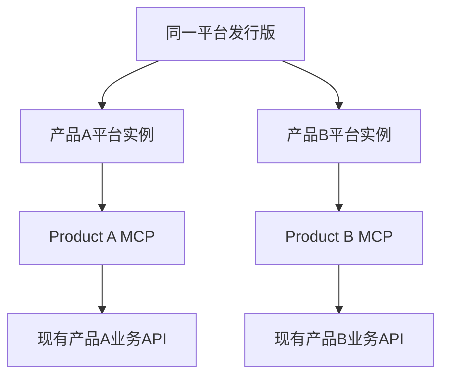
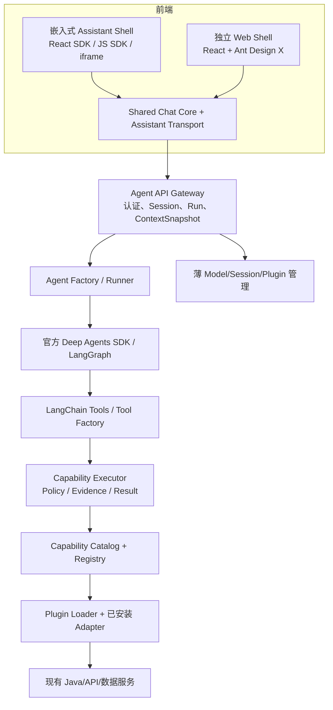

# 01 · 产品定位、总体架构与边界（V2.0）

> V2.2 更新：本章中的标准业务 Capability 与本地 Adapter Plugin 目标已由
> [22-V2.2-一系统一MCP架构](22-V2.2-一系统一MCP架构.md) 和 ADR-027 取代。平台不再建设跨系统
> 通用业务能力层；Product A/B/C 各自提供独立 MCP。Context、Evidence 和 Deep Agents 薄封装继续有效。

## 1. 产品定位

**企业业务智能体平台**，使用官方 Deep Agents 构建业务场景下的自然语言交互；通过受治理的 MCP
连接业务系统；从宿主页面获取可信校验后的场景 Context；在原平台授权和脱敏范围内查询，并提供可
追溯证据。平台不定义跨 Product A/B 的标准业务 Tool。

**定位关键词：边界清晰、可控、易集成、可扩展。** 不追求跨系统业务模型统一、OpenClaw 的广泛
渠道、插件生态数量或个人自动化功能。

## 2. 四个核心目标 + 一个核心扩展手段

| 属性                       | 核心设计                                              | 必须被测试验证的结果                               |
| -------------------------- | ----------------------------------------------------- | -------------------------------------------------- |
| **独立 MCP 接入**           | 每个系统独立 Tool/Schema；平台只做发现、批准和挂载     | Product A/B 无需共享业务契约，平台代码无业务分支   |
| **原业务权限继承**         | Gateway 主体认证、Policy、原平台对象/字段强制授权     | 越权请求被真实后端拒绝，即使篡改页面 Context       |
| **页面上下文感知**         | React/JS/iframe SDK、Context Adapter、ContextSnapshot | “当前表”能解析，切页不污染进行中的 Run             |
| **可信结果与溯源**         | Evidence、Result、统计口径、partial / insufficient    | 来源可查，缺失数据不编造，推断与事实分开           |
| **MCP 扩展（必要手段）**   | MCP Connection Registry + Snapshot + Tool Factory     | 批准 MCP 后挂载其原生 Tool，不需改 Agent 核心      |

## 3. 一套平台发行版、各系统独立 MCP

各实例独立管理模型配置、MCP 批准、会话/Checkpoints、凭证、用户身份和业务权限。**不做跨实例会话
连续性、跨系统业务归一化或动态产品路由。** 每个实例只连接当前配置批准的 MCP。

## 4. 逻辑架构

所有模块可先部署为一个 Node.js Agent Server，不进行人为微服务拆分。

## 5. 三条关键边界

**Agent 与业务边界**：Deep Agents 决定何时调用已经允许的 Tools；`Capability Executor` 执行契约校验、权限、输出与审计。业务 API 实际强制行列和对象权限。

**适配与标准边界**：产品原始字段、分页、枚举、错误码在 Adapter 内终结；模型/主 Tool 不出现 A/B/C 标识。**同名能力必须同义同口径，不能伪造不具备的数据**。

**运行与 Web 边界**：前端只理解标准消息、上下文、视图和 SSE 事件；React、JS、iframe 三种接入与独立 Web 共享 Chat Core 和 API；管理员功能只在独立 Web 暴露，服务端仍需校验管理员权限。

## 6. 技术选型

| 领域       | 选型                                               | 属性                   |
| ---------- | -------------------------------------------------- | ---------------------- |
| Harness    | 官方 `deepagents` TypeScript + LangChain/LangGraph | 直接复用，不 Fork      |
| Server     | Node.js + TypeScript                               | 单实例服务优先         |
| 原业务系统 | 现有 Java、HTTP 服务                               | 不要求改写业务数据模型 |
| 插件       | 本项目 Plugin SDK / Manifest / Loader              | 启动时自动发现，是 P0  |
| 前端       | React + TypeScript + Ant Design X / Ant Design     | Shared Chat Core       |
| 接入       | React SDK / Vanilla JS SDK / iframe                | 当前页面上下文传入     |
| 契约       | Zod + 版本化 JSON Schema（需要时）                 | 单一标准来源           |
| 会话       | 平台 Session + LangGraph Checkpointer              | 当前部署隔离           |
| 流式输出   | HTTP + SSE + 版本化事件协议                        | 结果、事件与证据       |

## 7. 明确不做

- 复制或重写 OpenClaw 的通用网关、多渠道 IM 连接、插件市场、热加载、第三方任意代码市场。
- 重写 Deep Agents Agent Loop、Skills 加载器、子智能体运行机制、LangGraph 状态机。
- 产品 A/B/C 之间统一会话、运行时切换 Adapter、远程集中管理所有部署。
- 在 V1.0 首版自动修改业务数据、删除资产或发布服务；先以只读查询、分析、推荐与草稿为主。
- 为方便 Demo 绕过授权/脱敏；不以 Prompt 自我约束代替服务端校验。

## 8. V1.0 MVP（由 V2.0 基线定义）

首个垂直切片：业务页面中“当前表最近 7 天的数据质量趋势”和数据地图对象查询。验证 **同标准契约、双插件、独立部署、权限阻断、上下文快照、证据和双 Web 模式**。原始 17 条需求是后续长期范围，不等于本次全部交付。

## 9. 版本政策

文件版本 `V2.0` 是**架构设计基线版本**；开发目标仍可称为产品 `V1.0 MVP`。M0 无论旧代码是否存在都按此新版重新验收，不得将旧 M0 结果自动算作通过。
