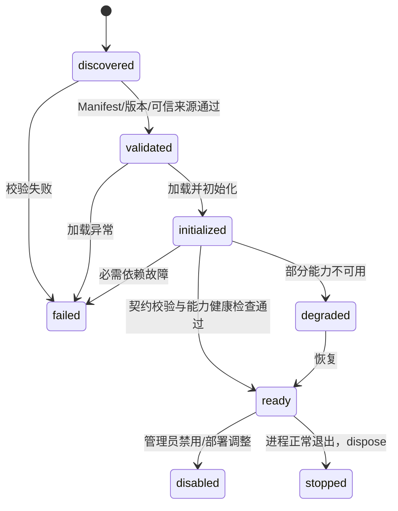

> **V2.0 适用说明：** 本章 V2.0 必备规范：插件启动自动发现与自动挂载仍属 P0；但不建设插件市场、热加载或通用第三方任意代码生态。 章节与 `01-架构基线与边界.md` 如有冲突，以后者为准。

# 05 · Plugin SDK、Manifest、Loader、Registry 与自动挂载

## 1. 架构目标

新建并构建插件 → 安装到当前实例目录 → 服务启动自动发现 → 校验和初始化 → 注册标准 Capability → Tool Factory 生成 LangChain Tools → Deep Agents 可调用。**主 Agent 完全不知道 A/B/C 产品身份**。

**重要边界**：Deep Agents 原生支持工具与 Skills，但**不会开箱即用扫描任意业务插件目录并自动安装 Adapter**；Plugin Runtime 是我们自主开发，禁止误导 Codex 去找不存在的 `deepagents.PluginLoader`。

## 2. Manifest V1

```json
{
  "manifestVersion": "1",
  "id": "data-governance",
  "name": "Data Governance Adapter",
  "version": "1.0.0",
  "apiVersion": "1",
  "runtime": { "type": "local", "entry": "./dist/index.js" },
  "capabilities": [
    { "id": "data_map.search_objects", "contractVersion": "1.0.0" },
    { "id": "data_quality.get_trend", "contractVersion": "1.0.0" }
  ]
}
```

`runtime.type` V1 允许 `local`、`http`；`mcp` 预留。`entry` 必须解析到已批准的插件根目录内，拒绝路径穿越、符号链接逃逸、未审核文件。插件 `id` 必须全局唯一；版本按 semver，插件 `apiVersion` 需与 Plugin SDK 协议匹配。可选 `configSchema`、`dependencies`、`healthCheck` 在 M1 先定义最小约定，不必做完整插件商店。

## 3. Plugin SDK 对外接口

### Manifest V2 补充

E2 在 V1 兼容基础上增加 Manifest V2。V2 仅允许受信任 Local Bundle，新增 `namespace`，并要求每项 Capability 声明 `contractSource`、`requiredPermission` 和 `riskLevel`；可声明插件根目录内的 `skills` 路径，但 E2 不加载 Skill 内容。Bundle 运行时同时导出 `contracts` 与 `capabilities`，二者必须与 Manifest 完全一致。

动态私有 Contract 的 `contractSource` 必须是当前插件 ID，命名空间和权限必须由部署显式批准，风险仅允许 `read`。引用平台 Contract 时，来源、权限和风险必须与 Catalog 注册信息一致。V1 Local/HTTP 继续支持；HTTP 不允许远程定义 Contract Schema。

Catalog 与 Capability Registry 返回可回滚注册租约。Provider 冲突、初始化或健康检查失败时，Runtime 撤销本 Bundle 的全部 Contract/Provider 注册并记录失败阶段。

### E3 Skill 声明与注册

Manifest V2 的 `skills` 兼容字符串路径，也支持对象声明：`path`、`requiredCapabilities`、`requiredConfig` 和 `requiredCredentials`。Manifest 是 Tool/配置/凭证依赖的唯一可信关联来源；`SKILL.md` 的 `allowed-tools` 只能引用该关联产生的 Tool 名，不能扩大 Tool 集合或授予权限。

Plugin Runtime 校验 Skill 真实路径、整个目录树的符号链接、单文件/总大小、标准 frontmatter、目录名一致性和内容哈希。所需 Tool、配置或凭证可用性不足时只排除该 Skill，保留已经健康的 Capability；同名可用 Skill 不按 Deep Agents 的默认顺序覆盖，而是在平台注册阶段失败关闭并回滚冲突 Bundle。诊断记录 Skill 来源插件、版本、内容哈希、所需 Tool、状态、排除原因和固定的 `overridePolicy=deny`，不返回 Skill 正文或凭据值。

下述 API 由**本项目实现**，不是 Deep Agents API：

```ts
export interface PluginHostServices {
  logger: {
    info(...args: unknown[]): void;
    warn(...args: unknown[]): void;
    error(...args: unknown[]): void;
  };
  config: Readonly<Record<string, unknown>>;
  credentials: { getSecret(reference: string): Promise<string> }; // 受控服务端调用
}
export interface CapabilityImplementation<Input, Output> {
  id: string;
  contractVersion: string;
  execute(input: Input, context: VerifiedCapabilityContext): Promise<CapabilityResult<Output>>;
}
export interface AssistantPlugin {
  capabilities: CapabilityImplementation<unknown, unknown>[];
  contextAdapter?: {
    normalize(raw: RawHostContext, verified: VerifiedPrincipal): Promise<NormalizedContext>;
  };
  initialize?(): Promise<void>;
  healthCheck?(): Promise<{ ok: boolean; details?: string }>;
  dispose?(): Promise<void>;
}
export type PluginFactory = (host: PluginHostServices) => Promise<AssistantPlugin>;
```

`definePlugin()`/`implementCapability()` 作为泛型封装帮助开发者复用 Catalog Schema、推断类型、拒绝未知能力。输入输出使用标准契约统一校验；插件只实现业务查询和映射，不自己创建 LangChain Tool。

**示意插件使用**：

```ts
import { definePlugin, implementCapability } from "@assistant/plugin-sdk";
import { qualityTrendV1 } from "@assistant/capability-contracts";
export default definePlugin(({ businessClient }) => ({
  capabilities: [
    implementCapability({
      contract: qualityTrendV1,
      async execute(input, ctx) {
        const raw = await businessClient.qualityTrend(input, ctx); // 接口由插件注入/实现
        return mapToStandardResult(raw); // 插件函数
      },
    }),
  ],
}));
```

`businessClient`、`mapToStandardResult` 为示意自研接口，M1 代码须实现或换成明确存在的依赖。

## 4. 生命周期状态机



**M1** 只需启动发现与受控加载，不做热加载。插件健康失败时必需插件可阻断启动；可选插件降级但不可暴露错误工具。注册表仅表示插件可用，不表示当前用户已授权。

## 5. 发现与装配伪代码

```ts
const manifests = await pluginDiscoverer.scan(approvedPluginDir);
for (const manifest of manifests) {
  const record = await pluginValidator.validate(manifest); // 白名单/路径/哈希/兼容
  const plugin = await pluginLoader.load(record); // 受信任本地 JS
  await plugin.initialize?.();
  await pluginRegistry.register(record, plugin);
  await capabilityRegistry.registerMany(record, plugin.capabilities);
}
const exposedTools = toolFactory.createFrom(capabilityRegistry.listAvailable());
const agent = createDeepAgent({ model, tools: exposedTools });
```

以上是**流程伪代码**。`scan/load/validate` 及 `registerMany`、`createFrom` 必须在 M1 实现；`createDeepAgent` 由官方包提供，参数以 M0 锁定版本为准。

## 6. Capability Catalog、Registry 和 Dispatcher 分工

- **Catalog**：统一的语义、Zod 输入/输出 Schema、权限要求、风险等级、契约版本；可在没有插件时存在。
- **Plugin Registry**：插件清单、版本、健康与启动日志；管理 UI 读取的状态。
- **Capability Registry**：当前部署的 `CapabilityId@ContractVersion -> Provider` 绑定及可用性。
- **Plugin Skill Registry**：当前启动中已验证且依赖满足的 Skill；同名拒绝覆盖，生成 Agent 启动快照。
- **Dispatcher**：解析已绑定 Provider 并委派给 Local/HTTP 驱动；禁止业务 `switch(product)`。
- **Executor**：标准输入校验 → Policy → Driver → 输出校验/脱敏 → Evidence/Audit → CapabilityResult。
- **Tool Factory**：Catalog 映射成 LangChain `tool()`，名称稳定（如 `data_quality_get_trend`），执行调用 Executor。User/tenant/secret **不进入模型工具入参**。

## 7. Local / HTTP / MCP

| Driver | M1 范围               | 注意                                                                           |
| ------ | --------------------- | ------------------------------------------------------------------------------ |
| Local  | 必须实现              | 执行可信模块，同进程无天然沙箱；阻止不受信任 JS                                |
| HTTP   | 必须实现简单协议      | 服务端凭证转发、超时/幂等/错误归一化；支持原 Java API 的薄适配                 |
| MCP    | 不进入 M1，仅留扩展点 | 以后由 MCP 客户端发现工具，再映射标准 Capability；鉴权和 Schema 仍由 Core 控制 |

HTTP 标准调用接口示例：`POST /capabilities/{capabilityId}/invoke`，请求含契约版本、input、traceId，用户权限由服务端传递，不从模型输入中信任 `userId`。响应统一 `CapabilityResult`。

## 8. 安全约束

- 扫描**安装的构建产物**而非运行时扫描未经审核 TypeScript 源码；记录安装包哈希/批准来源。
- `plugin.json` 不得包含密钥；Plugin Host 仅按受控配置提供密钥访问。
- 动态 import 会执行代码，必须与上游供应链信任绑定；不宣称它是沙箱。
- Tool 动态可见集合只用于降低噪声，**每次调用执行端仍必须授权**。
- 冲突、重复注册、Manifest 与实现不一致均应生成有界错误；不允许“后注册覆盖前注册”。

## 9. 自动挂载测试清单

1. 仅安装 demo A 时扫描得到 A 的 2 项能力；启动日志可见名称和版本。
2. 换成 demo B 目录后无需改 Agent Factory/Tool Factory/Chat UI，得到相同能力工具列表。
3. A/B 原始 JSON 不同，但输出同时满足 Catalog Schema。
4. 在已构建 Agent 上调用工具得到实际插件结果（不是 Agent 文字冒充执行）。
5. 非法 entry、版本不兼容、重复 ID、缺少必需 Capability、Schema 违规、插件不可用均可被测试稳定识别。
6. 模型试图通过工具入参指定其他用户时无效，因为执行上下文仅来自服务端。
