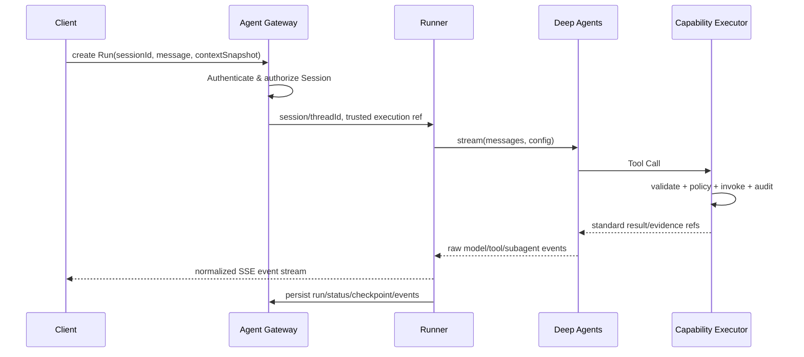

> **V2.0 适用说明：** 本章 V2.0 支撑规范：直接使用 Deep Agents 的公开扩展接口；Agent Factory 只装配，不能重新实现 Harness。 章节与 `01-架构基线与边界.md` 如有冲突，以后者为准。

# 06 · Agent Factory、Runner、Skills、Subagents 与 LangGraph Runtime

## 1. 核心原则

官方 `deepagents` 是 Agent Harness；我们实现 `AgentFactory`（装配）与 `AgentRunner`（生命周期/流/会话），**不复制官方 Agent Loop、不修改内建 Middleware 源码**。必要自定义能力优先走 `tools`、`subagents`、`skills`、`middleware`、`backend`、`checkpointer`、`contextSchema` 公共参数，实际可用性由 M0 锁定版本与类型检查确认。

## 2. 官方最小示例（与自研接口分离）

```ts
import { createDeepAgent } from "deepagents";
import { tool } from "langchain";
import { z } from "zod";
const ping = tool(({ text }) => `pong: ${text}`, {
  name: "ping",
  description: "Return ping response",
  schema: z.object({ text: z.string() }),
});
const agent = createDeepAgent({ tools: [ping], systemPrompt: "Use tools when needed." });
const result = await agent.invoke({
  messages: [{ role: "user", content: "Call ping with hello" }],
});
console.log(result.messages.at(-1)?.content);
```

运行此示例需要可用的模型和相应配置。**本示例来自官方允许的 API 形态，具体 Node/SDK/模型与依赖安装由 M0 验证。** 不把 `AgentFactory.get()`、`toolFactory.create()` 等平台设计方法误当成官方 API。

## 3. Agent Definition（平台配置）

```ts
export interface AgentDefinition {
  id: string;
  version: string;
  enabled: boolean;
  modelConfigId: string;
  promptRef: string;
  capabilitySelectors: string[]; // 如 data_map.*, data_quality.*
  skillIds: string[];
  subagentIds: string[];
  planningPolicy: "default" | "explicit";
  limits: { timeoutMs: number; maxSteps?: number };
}
```

`planningPolicy` 是平台配置，不对应官方一模一样的字段。**规划功能是否默认启用与开启方式须由 M0 核对所安装版本**。运行次数/超时/递归限制要映射到已验证的 LangGraph 参数和 AbortController，不直接传递不存在的 `maxIterations` 字段。

## 4. Agent Factory 装配次序

1. 从 Agent Registry 取配置并锁定版本；检查 enabled。
2. Model Resolver 选有权限的模型；获取 Secret 引用、创建 ChatModel；用户凭证不放入全局实例。
3. Capability Registry 提供当前实例可用的标准能力；按 Agent 选择器和风险级别筛选；Tool Factory 创建 Tool 包装。
4. Subagent Factory 显式指定专业 Agent 名称、描述、Prompt 和最小工具集合；不可默认暴露所有工具。
5. Skills Resolver 将经审核的 `SKILL.md` 路径装配为官方可读的 Backend 路径；必要时选择只读权限。
6. 绑定 Checkpointer/Backend/自定义 Middleware、可信 `contextSchema`；调用官方 `createDeepAgent`。
7. 使用 `agentConfigVersion + modelConfigVersion + capabilitySetVersion + skillSetVersion` 做缓存键；**不以用户身份生成长生命周期的全局共享密钥配置**。

## 5. Agent Runner 运行流程



**Run 与 Session 分开**：Session 是产品记录/标题/权限主体，LangGraph Thread 是 Checkpointer 标识，Run 是某一次执行，Message 是用户/AI 消息。`thread_id`/`sessionId` 在服务端做归属校验，不能客户端任意指定一个 ID 即读取他人状态。

## 6. Runtime Context 与工具边界

官方支持使用 `contextSchema` 建模 run context，但 API 细节随版本变化。第一版仅传入服务端可信的 `executionContextId` / `contextSnapshotId` 等引用，Tool Wrapper 再由服务端获取已验证用户、授权范围与凭证，避免把授权信息直接交给模型。

```ts
const runContextSchema = z.object({ executionContextId: z.string() });
// 示例：以 M0 安装的 SDK 类型检查为准
const agent = createDeepAgent({ tools, contextSchema: runContextSchema });
```

**绝不**让 LLM Tool Schema 包含 `userId`、`tenantId`、`credentialRef` 并以这些值作鉴权依据。

## 7. Skills、Backend、Memory、Checkpoint 的区别

| 概念            | 官方或平台责任               | 注意                                                           |
| --------------- | ---------------------------- | -------------------------------------------------------------- |
| Skills          | Deep Agents 加载按需专业说明 | 路径应映射到 Backend，审核技能内容                             |
| Backend         | 文件/工作空间操作            | 与真实宿主磁盘不一定相同；默认 StateBackend 不等于长期文件存储 |
| Memory          | 长期规则/知识                | 不存用户私密业务查询结果作为跨用户通用记忆                     |
| Checkpointer    | LangGraph 执行/中断状态      | 需要持久化驱动、thread_id、权限隔离                            |
| Session Service | 我们的平台会话 CRUD/归档     | 不等于 Checkpointer                                            |

M0 实测：Skills 能被读取；Tool/Subagent Stream 能被监听；Checkpointer 同一 threadId 能继续；重启后持久化根据 M2 驱动验证。

### E3 Plugin Skill 启动快照

Agent Server 在 Plugin Runtime 完成 Contract、Provider、Skill 校验后，把可用 Skill 目录复制到仅包含 Skill 资产的临时启动快照，并在复制后复核目录树哈希；随后以 `FilesystemBackend({ virtualMode: true })` 和官方 `skills` 参数装配 Deep Agents。文件权限只允许读取 `/skills/**`，拒绝写入和读取快照外路径。Agent 创建后固定 Tool 与 Skill 集合，不刷新安装目录；插件新增、删除、禁用或内容更新均需重启。官方线程级 Skill 缓存继续保留，但平台不调用刷新入口实现热加载。

Skill 指令、描述及其外部引用不构成事实、Evidence、身份、权限或凭证。系统 Prompt 明确要求业务事实来自受控 Tool 和服务端验证的 Evidence；所有 Tool 调用仍经过 Capability Executor。

## 8. Subagents 策略

- 简单查数优先主 Agent 直接调用 Tool；多步专业分析按需委派。
- 专业领域 `data-quality-agent` 只看它被授权的质量 Tool，不继承高风险管理工具。
- Subagent Prompt 说明“只从工具得到事实、不给出无依据的确定性因果结论”。
- 首版一个示例子 Agent 即可；未来领域分别定义在 `domains/{domain}/`。
- Run 事件记录子 Agent 的**执行状态**，不暴露模型的隐藏推理过程。

## 9. Streaming/Event Bridge

Deep Agents/LangGraph `stream` 输出的事件是**官方内部/原生结构**，客户端协议是我们自定义。不得让 Ant Design X 直接解析 LangGraph 的 raw chunk；Event Bridge 负责：事件映射、SSE 编号、内容合并、错误归一化、子图命名空间、取消状态、审计关联。`streamMode: 'updates'`、`subgraphs: true` 的具体返回形态在 M0 打印并添加测试。

## 10. 执行限制、回退和恢复

- HTTP Run 要有幂等键、服务端 Run 状态及 Abort 语义；超时后的 Tool 需符合自身超时与重试规则。
- 只读工具可对明确可重试的网络错误实施有界重试；写操作（未来）必须独立设计幂等/审批。
- 断流不应强行中断后端 Run；客户端可通过 `runId` + `Last-Event-ID` 重连，视 M2 事件日志实现。
- 模型不可用时返回标准错误并记录，不偷偷切换到未经配置/未授权的模型。
- 不把 LangGraph Checkpoint 原始 blob 完整返回浏览器。

## 11. 官方资料

- https://docs.langchain.com/oss/javascript/deepagents/customization
- https://docs.langchain.com/oss/javascript/deepagents/skills
- https://docs.langchain.com/oss/javascript/deepagents/subagents
- https://docs.langchain.com/oss/javascript/deepagents/streaming
- https://github.com/langchain-ai/deepagentsjs
