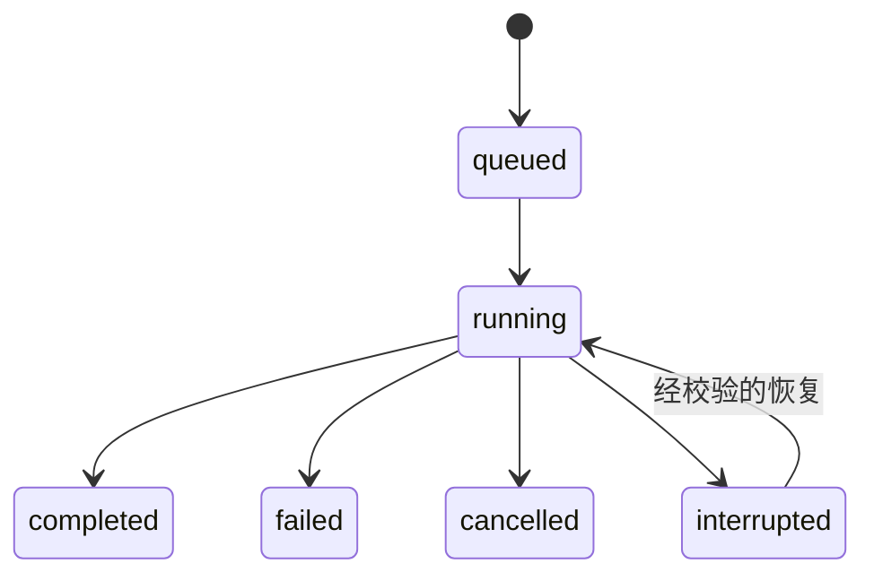

> **V2.0 适用说明：** 本章 V2.0 支撑规范：只实现满足 Chat、Session、Context、Tool 和审计的必要 API，不开发通用多渠道 Gateway。 章节与 `01-架构基线与边界.md` 如有冲突，以后者为准。

# 09 · 平台 HTTP API、数据模型及流式协议

> 以下是自研平台协议设计（V1 草案），不是 Deep Agents 内置 HTTP 路由。M2 实现时以 OpenAPI + Zod + 集成测试作为契约权威。

## 1. API 总则

- 前缀 `/api/v1`；服务端支持身份认证、跨源配置、Request ID、错误格式统一。
- 用户/管理员 API 角色区分；所有对象的查询都需要数据归属检查。
- 资源访问主键不得等同授权凭据；UUID 猜测不能越权。
- 标准错误 `{ code, message, traceId, details? }`，不暴露内部堆栈或凭证。

## 2. 核心 API 列表

| 方法和路径                   | 权限                        | 作用                                |
| ---------------------------- | --------------------------- | ----------------------------------- |
| `POST /sessions`             | 登录用户                    | 创建 Session                        |
| `GET /sessions`              | 当前用户                    | 查询当前用户会话，可分页搜索        |
| `GET /sessions/:id`          | 会话所有者                  | 会话详情                            |
| `GET /sessions/:id/messages` | 会话所有者                  | 历史消息                            |
| `PATCH /sessions/:id`        | 会话所有者                  | 修改标题/归档                       |
| `DELETE /sessions/:id`       | 会话所有者                  | 删除/软删除，按政策                 |
| `POST /sessions/:id/runs`    | 会话所有者                  | 创建 Run，带 idempotency key        |
| `GET /runs/:id`              | Run 所属用户                | Run 状态                            |
| `GET /runs/:id/events`       | Run 所属用户                | SSE 事件/重连                       |
| `GET /runs/:id/ag-ui/events` | Run 所属用户                | 同一事件日志的 AG-UI 1.0 投影/重连 |
| `POST /ag-ui`                | 已登录用户 + Session/Snapshot 所属 | 标准 `RunAgentInput` 创建受控 Run 并返回 AG-UI SSE |
| `POST /runs/:id/cancel`      | Run 所属用户                | 取消 Run                            |
| `POST /context/snapshots`    | 登录用户                    | 校验 Raw Context 并创建快照         |
| `GET /evidence/:referenceId` | 有权用户                    | 解引用证据，重新鉴权                |
| `GET /models`                | 登录用户可用模型/管理员全量 | 模型列表                            |
| `POST/PATCH /models`         | 管理员                      | 模型配置维护（绝不返回明文 Secret） |
| `GET /plugins`               | 管理员                      | 当前实例插件状态                    |
| `GET /capabilities`          | 登录用户/管理员限定范围     | 可用标准能力                        |

注：完整 API 需要补 `pagination`, `sort`, `filter`, HTTP 状态码、OpenAPI 文档和权限描述；M2/M3 逐项实现。路径实际落地时在服务器统一添加 `/api/v1` 前缀。

## 3. Session / Run / Message / Thread 四者关系

```text
AssistantSession (id, ownerId, tenantId?, title, mode, agentId, threadId, status)
  ├── Run 1 (runId, modelConfigVersion, contextSnapshotId, status)
  ├── Run 2 (...)
  └── Messages (messageId, role, content, evidenceRefs, runId?)
LangGraph Thread / Checkpoints 由 session.threadId 关联；Checkpoint 存储与会话元数据分离。
```

数据库建议逻辑表：`assistant_sessions`, `assistant_runs`, `assistant_messages`, `context_snapshots`, `audit_records`, `evidence_records`, `model_configs`, `plugin_load_records`, `run_events`。Checkpointer 使用选定适配器的持久化存储。M2 需迁移脚本、索引、删除/归档策略和基本数据清理方案。

## 4. Run 状态机



一个 Session 同时多个 Run 的并发/队列策略应在 M2 明确；MVP 推荐同一 Session 对话 Run 串行，以免 Thread/消息顺序冲突。

## 5. `POST /runs` 请求示例

```json
{
  "message": "分析当前数据表最近七天的质量变化",
  "contextSnapshotId": "ctx-001",
  "clientRequestId": "request-unique-001"
}
```

成功返回 `202 Accepted` + `{runId, sessionId, status:'queued', eventsUrl}`（示意）；需要做 `clientRequestId` 的幂等绑定，重复请求不能产生两个相同 Run。

## 6. 统一 SSE 事件信封

```ts
interface AssistantEvent<T = unknown> {
  version: "1";
  eventId: string;
  sequence: number;
  sessionId: string;
  runId: string;
  timestamp: string;
  type: string;
  data: T;
}
```

必需事件：`run.started`、`message.delta`、`tool.started`、`tool.completed`、`tool.failed`、`view.created`、`evidence.added`、`run.completed`、`run.failed`；扩展事件：`subagent.started/completed`、`approval.required`、`run.interrupted`、`run.cancelled`。所有事件都使用 Zod 版本化验证。

SSE 示例：

```text
id: evt-000012
event: tool.completed
data: {"version":"1","eventId":"evt-000012","sequence":12,"sessionId":"s1","runId":"r1","timestamp":"2026-10-13T00:00:00Z","type":"tool.completed","data":{"toolCallId":"tc1","toolName":"data_quality_get_trend"}}

```

重连：按 `Last-Event-ID` 或 query cursor 拉取仍在保留期限的事件；服务端校验归属、幂等重放，前端根据 `eventId/sequence` 去重。若事件日志已过期，返回清晰的 `EVENT_CURSOR_EXPIRED` 让前端通过 Session/Run 状态重新同步；绝不宣称无状态 SSE 自动有完整恢复。

### 6.1 AG-UI 1.0 兼容投影

依据 ADR-024，现有 `AssistantEvent` 是持久化与重放的事实来源；AG-UI 事件是其确定性客户端投影。`run.started/completed/failed/cancelled`、文本、Tool 和 Subagent 映射到 AG-UI 标准事件；Evidence 与受控 View 使用版本化 `CUSTOM` 名称及项目 Schema。一个源事件映射多个 AG-UI 事件时，投影 ID 使用源 `eventId` 加稳定序号，源序列与 Session 写入 `enterprise-assistant` metadata。

该投影不改变 `/sessions`、`/runs`、`/context/snapshots`、`/evidence` 的权限和资源语义，也不表示标准 AG-UI `HttpAgent` 可以绕过 Gateway。`GET /runs/:id/ag-ui/events` 复用 Bearer 认证、Run 归属和限流；`Last-Event-ID` 使用版本化 AG-UI 投影游标，服务端重建源事件对应的投影状态，从精确的子事件位置继续。

`POST /ag-ui` 接收官方 `RunAgentInput` Schema，但 `threadId` 只作为已有 Session ID 使用，`runId` 只作为幂等键和公开 AG-UI Run 标识；两者都不能建立身份。调用方必须先通过受控 Context API 创建快照，并在 `forwardedProps.enterprise-assistant.contextSnapshotId` 传递其引用，服务端再次校验用户和租户归属。`context/state` 不参与授权，客户端 `tools`、非文本输入和 interrupt resume 在当前只读阶段失败关闭。该 POST 响应流被提前取消时，服务端以内部 Run ID 和建立流时的认证主体执行 durable cancel；GET 重放流断开不取消 Run。显式取消、Evidence 与历史管理仍保留原企业 REST 资源。

## 7. Context 协议

`POST /context/snapshots` 只接收 Raw Context（页面/对象/业务相关字段），服务端根据当前用户校验/归一化；返回 `{id, version, capturedAt}`。`run` 引用已授权的 Snapshot，不允许跨用户使用。StandAlone 用户对象选择也经过相同服务端校验。

## 8. 模型和插件管理约束

`model_configs` 保存供应商/模型 ID/能力标签/启用状态/版本与 `credentialRef`，不保存或返回明文凭证。默认模型修改不改变已在运行中的 Run 配置快照。  
`plugin_load_records` 由实际 Loader 启动事件生成；后台页面不能随意把任意上传文件作为插件立即执行。热启停放后续版本。

## 9. ViewModel 事件

`view.created` 数据示例：

```json
{
  "viewId": "view-001",
  "viewType": "chart.line",
  "schemaVersion": "1",
  "title": "最近七天质量趋势",
  "data": { "xField": "time", "yField": "value", "rows": [] },
  "evidenceIds": ["evidence-001"]
}
```

`rows:[]` 表示示例空数据，不得被客户端自行解释为评分零。Renderer 按受信任类型渲染，不执行外部 JS。

## 10. Contract Testing

所有 API 产生 OpenAPI 文档与 Zod Validator；前端代码应从共享契约使用类型或由生成器生成客户端。集成测试必须覆盖 API 正常、401、403、404、409、429、5xx、超时、数据不足、SSE 重连、并发 Run 与幂等请求。
