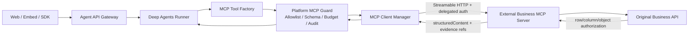

# 21 · V2.1 外部 MCP 业务能力架构

> 状态：Superseded by V2.2 / 仅保留迁移历史
> 后继决策：`22-V2.2-一系统一MCP架构.md`、ADR-027。跨产品标准业务 Tool、共享 Domain 和 A/B 契约
> 一致性不再是目标架构。
> 生效日期：2026-10-21
> 决策来源：ADR-026
> 优先级：本文件覆盖 `01`、`03`、`05`、`11`、ADR-003/004/013/022/023 中与本地 Plugin Bundle 作为目标形态冲突的内容；历史验收记录不改写。

## 1. 决策摘要

业务能力不再以 `Deep-Agents-AI-Assistant` 仓库内的 Adapter、Domain、Skill 和 Plugin Bundle 交付。
目标形态由独立仓库 `E:\Deep-Agents-AI-Assistant-MCP` 开发和发布 MCP Server，主仓作为 MCP Host，
通过受治理的外部 MCP 连接发现、批准、注册和调用业务 Tool。

这不是把远端 Tool 直接交给模型。主仓继续拥有身份、ContextSnapshot、Run、平台 Policy、
Evidence 安全传输/Audit、调用预算和回答发布门禁。MCP Server 继续对原业务 API 执行业务权限、
对象、行、列和脱敏授权；
两侧均不能把 Prompt、页面 Context 或 MCP Tool 描述视为授权。

## 2. 平台能力与业务能力的硬边界

| 类型 | 归属 | 示例 |
| --- | --- | --- |
| 平台能力 | `Deep-Agents-AI-Assistant` | 身份接入、Session/Run、ContextSnapshot、模型与 Agent Runtime、MCP 连接治理、调用预算、审计事件、AG-UI/SSE、Web/Embed/SDK |
| 业务能力 | `Deep-Agents-AI-Assistant-MCP` | 数据地图、数据质量、订单/客户/资产查询、业务字段与口径、业务权限名称、产品 API 映射、业务 Evidence 生成与解析、业务 Prompt/Resource |

主仓不得维护业务 Capability Catalog、业务 ID 保留命名空间、业务输入/输出 Schema、业务错误语义、
业务权限名称或 A/B 产品契约测试。MCP Server 的 `tools/list` 和版本化业务协议是业务能力的事实来源；
主仓只对发现结果做连接批准、完整性固定、通用 JSON Schema 校验、大小/超时/预算控制和安全适配，
不解释业务字段含义。

主仓可保留与领域无关的平台安全信封，例如调用状态、审计关联 ID、受控展示和 Evidence opaque 引用，
但信封不得枚举业务类型、业务错误码或业务权限。业务数据 Schema 与业务 `success/partial/error` 口径由
MCP 仓定义，主仓仅机械验证 MCP 声明的输出 Schema 并传递安全结果。

## 3. 两个仓库的职责

### `Deep-Agents-AI-Assistant`

- Deep Agents Harness、Agent API、Session/Run、AG-UI/SSE、Web/Embed/SDK。
- 平台身份、平台 Policy、Evidence opaque 引用传输、Audit 和受控 View 协议。
- MCP Connection Registry、批准策略、客户端生命周期、健康状态和 Tool Snapshot。
- 将已批准的 MCP Tool 转换为 LangChain Tool；机械执行 MCP 声明的输入/输出 Schema，并控制超时、大小和预算。
- 按当前已认证主体获取短期、audience-bound 的委托凭证；凭证不进入 Tool 参数、Prompt、日志或浏览器。
- 不再开发或维护业务 Capability Catalog、业务 Contract、业务权限语义、产品 Adapter、业务 Skill 或本地插件模板。

### `Deep-Agents-AI-Assistant-MCP`

- 跨产品标准和部署私有的业务 Tool 定义、JSON Schema、语义说明与契约测试。
- Product A/B/C 原始 API 到标准业务 Tool 的映射。
- MCP Server、上游业务 API Client、业务权限语义、最终业务授权、脱敏和 Evidence 生成/解析。
- 业务 Prompt/Resource；它们仍是不可信内容，不能声明权限、凭证或可信 Evidence。
- MCP Server 模板、开发文档、部署产物和独立测试。

## 4. 目标运行链路



生产目标传输是带 TLS 的 Streamable HTTP。`stdio` 只用于本地开发和契约测试，不是生产跨服务部署方式。
不把旧 SSE transport 作为新实现目标；是否兼容旧协议由 MCP Spike 根据实际 SDK 和目标服务决定。

## 5. MCP Tool 治理契约

### 5.1 稳定身份

MCP 原生 `tool.name` 是传输级名称。业务语义元数据由 MCP 仓定义和版本化，主仓将其视为 opaque
审计/批准字段，不据此实现业务逻辑。每个业务 Tool 至少提供：

- `capabilityId`：稳定业务 ID，例如 `data_quality.get_trend`。
- `contractVersion`：业务契约 SemVer。
- `requiredPermission`：MCP Server 和原业务系统理解的业务权限名；主仓不解释或代替执行。
- `riskLevel`：供平台做通用调用风险门禁的分类；首个迁移阶段只批准 `read`。
- `resultEnvelopeVersion`：MCP 仓维护的业务结果信封版本。
- `schemaDigest`：对规范化输入/输出 JSON Schema 计算的摘要。

上述元数据的具体 MCP `_meta` key、Tool 命名规则和规范化摘要算法必须在 MCP-1 Spike 中以官方 SDK
真实类型和协议测试固定，本文不把示意名称当成已实现 API。

### 5.2 发现不等于批准

连接成功和 `tools/list` 仅产生候选 Tool。注册前必须同时满足：

1. MCP Server ID、URL、传输、认证模式和允许的网络目标在部署配置中批准。
2. Tool 名、业务契约版本、风险和 Schema 摘要与批准快照一致；主仓不维护业务 Catalog。
3. Tool 名、Capability ID、模型可见名称不存在冲突。
4. 输出声明包含可校验的结构化结果；纯文本只能作为辅助展示，不能成为可信业务结果。
5. 当前阶段没有未批准的动态新增、删除或 Schema 漂移。

首版在应用启动时形成不可变 Tool Snapshot。远端列表变化只将连接标为 `drifted/degraded`，不热更新当前
Agent；管理员批准并重启后才生效。

### 5.3 调用边界

- Agent 只能提供业务参数，不能提供 `userId`、`tenantId`、访问 Token、权限列表或 Evidence 真伪标记。
- 主仓从可信 Run/ContextSnapshot 建立调用上下文，在调用前执行连接/Tool allowlist、通用风险和预算策略；
  不判断业务对象、行、列或业务功能权限。
- MCP Server 从认证上下文恢复当前主体，并由原业务 API 再次执行对象/行/列权限与脱敏。
- MCP `isError`、协议错误、连接失败、超时、Schema 错误与业务 `partial/error` 必须映射为稳定平台错误，
  不得把网络故障伪装为空数据。
- Tool 输出视为不可信输入：限制大小、内容类型和日志字段，并防止 Prompt Injection 进入系统指令。

## 6. 身份、凭证与 Evidence

- 生产 MCP 调用使用短期、最小权限、绑定目标 MCP audience 的委托凭证；服务间固定凭证只能标识服务，
  不能替代最终用户授权。
- 委托凭证由主仓 Credential Broker/Auth Provider 在请求时获取，不写入 MCP Tool arguments、URL、
  Tool 描述、持久事件或 Audit 明文。
- MCP Server 返回其业务协议定义的 `structuredContent`，其中 Evidence 对主仓只暴露安全元数据和 opaque
  `referenceId`。
- Evidence 展示时必须以当前主体重新鉴权。MCP-2 需固定通过受控 MCP Resource 或专用只读 Tool
  进行解析；在该链路完成前，不迁移生产 Evidence Resolver。
- MCP Prompt、Resource 文本和 Tool 描述不能生成 `verified=true`，也不能扩大 Tool 集合或权限。

## 7. 四个目录的迁移归属

| 当前主仓目录 | 目标 MCP 仓位置 | 迁移说明 |
| --- | --- | --- |
| `adapters/*` | `servers/*` 或 `packages/adapters/*` | 每个产品成为独立 MCP Server 组合根或内部 Adapter；不再由 Agent Server `import()` |
| `domains/*` | `domains/*` | 保留业务语义、Schema 和共享契约测试，但发布/部署属于 MCP 仓 |
| `skills/*` | `prompts/*` / `resources/*` | 仅迁移业务指导内容；不自动等价为 Deep Agents Skill，必须单独批准和快照 |
| `templates/plugin-bundle-v2` | `templates/mcp-server` | 替换 Manifest/入口模板为 MCP Server、Tool、认证和契约测试模板 |

`packages/plugin-sdk`、`packages/plugin-runtime`、本地插件发布器及 `PLUGINS_DIR` 在迁移期保留为回滚路径，
但从本决策起冻结新增业务能力。完成双轨对比和切换后，再在独立清理阶段移除；本轮不删除。

## 8. 目标工程结构

```text
Deep-Agents-AI-Assistant/
├─ apps/agent-server/
├─ core/{context,policy,evidence}/
├─ packages/
│  ├─ agent-runtime/
│  ├─ mcp-client-runtime/       # MCP-1 已创建
│  └─ ... UI / transport / SDK
└─ docs/

Deep-Agents-AI-Assistant-MCP/
├─ domains/
│  ├─ data-map/
│  └─ data-quality/
├─ servers/
│  ├─ demo-product-a/
│  └─ demo-product-b/
├─ prompts/
├─ packages/                    # 通用 MCP server/auth/result 支撑，按真实复用再创建
├─ templates/mcp-server/
├─ tests/
└─ docs/
```

禁止通过相对路径、workspace 或 `file:` 依赖把两个仓库重新耦合。共享协议必须使用版本化发布包或固定的
JSON Schema/协议制品，并进行兼容性测试。

迁移完成后，现有 `core/capability` 不保留为业务 Catalog。仍被平台需要的纯技术逻辑迁入
`mcp-client-runtime`、平台 Policy/Audit 或通用协议模块；业务 Contract、Provider Registry 和 Executor
语义随旧 Plugin Runtime 一并移除。

## 9. 迁移阶段与退出门禁

### MCP-0：架构冻结（本阶段）

- 接受 ADR-026，明确仓库边界、安全不变量、迁移顺序和回滚路径。
- MCP 仓建立开发边界；不声称 SDK、连接、Tool 或真实业务 API 已实现。

### MCP-1：只读垂直切片

- 根据实际安装包锁定官方 MCP TypeScript SDK 版本和协议版本。
- MCP 仓实现一个 `data_quality.get_trend` Server；主仓实现最小 Client Manager 和 Tool Factory。
- 真实验证 initialize/discovery、`tools/list`、`tools/call`、结构化输出、超时、取消、关闭和 Schema 漂移。
- 主仓旧 Adapter 与 MCP 路径针对同一测试向量双跑，输出语义一致；模型只启用其中一条路径。

### MCP-2：可信执行闭环

- 完成用户委托认证、对象权限拒绝、Evidence 重新鉴权、Audit、重连和健康状态。
- 覆盖 SSRF、重定向、DNS/Host allowlist、TLS、凭证泄漏、Tool 输出注入和超大结果。
- Product A/B 两个独立 MCP Server 通过共享业务契约测试。

### MCP-3：业务资产迁移

- 迁移 `domains`、`adapters`、业务 `skills` 和模板；Prompt/Resource 使用显式批准与快照。
- 更新 Demo、部署、运维和开发指南；主仓停止打包业务插件并停止发布业务契约包。

### MCP-4：切换与清理

- 至少完成一次可回滚发布和观测窗口后，默认关闭本地 Plugin Runtime。
- 单独审计并移除四个旧目录、Plugin SDK/Runtime、发布器、旧环境变量和回归测试。
- 删除是独立任务，必须先确认 Git 状态、替代覆盖和恢复点，不能在迁移阶段顺带执行。

## 10. 本阶段非目标

- 不把任意公网 MCP Server 自动暴露给 Agent。
- 不建设 MCP 市场、跨实例中心化路由或运行时热加载。
- 不在 MCP Server 中托管 Agent 会话、模型配置或 LangGraph Checkpoint。
- 不用 MCP Prompt 取代服务端 Policy，不用 MCP Resource 取代 Evidence 重新鉴权。
- 不在当前 Runtime Policy 未完成门禁时改写主仓运行时代码。

## 11. 官方接口验证基线

MCP-1 只能以实际锁定的官方 TypeScript SDK 类型和集成测试为准。设计调研确认官方客户端提供
`Client`、Streamable HTTP/stdio transport，以及 `listTools`、`callTool`、`listResources`、
`readResource`、`listPrompts`、`getPrompt` 等能力；具体 import path、协议协商和认证 API 在实现时必须
重新核验，不能从本文示意代码推断。

实现前参考并重新核验：

- [官方 TypeScript SDK：Build your first client](https://github.com/modelcontextprotocol/typescript-sdk/blob/main/docs/get-started/first-client.md)
- [官方 TypeScript SDK：Connect to a server](https://github.com/modelcontextprotocol/typescript-sdk/blob/main/docs/clients/connect.md)
- [官方 TypeScript SDK：Protocol versions](https://github.com/modelcontextprotocol/typescript-sdk/blob/main/docs/protocol-versions.md)
