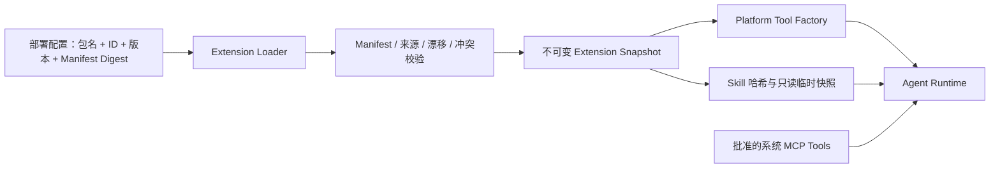

# 23 · Platform Extension：平台 Plugin、Skills 与 Tools

> 状态：Accepted architecture / PEX-1 implementation in progress  
> 生效日期：2026-10-23  
> 决策来源：ADR-028  
> 与 V2.2 的关系：补充纯平台扩展机制，不恢复旧业务 Plugin Runtime，不改变一系统一 MCP。

## 1. 目标与术语

Platform Extension 是部署安装与治理单元。它可以贡献经审核的纯平台 Tool、Deep Agents Skill，以及
后续经单独批准的有限平台基础设施 Provider。Plugin 是产品/UI 可使用的通俗名称，不代表旧
Capability/Adapter Plugin Runtime。

- **Plugin / Platform Extension**：安装、版本、批准、诊断和停用单元。
- **Skill**：按需加载的方法说明，不是事实、身份、权限或凭证来源。
- **Platform Tool**：操作平台自身对象的模型可调用能力；PEX-1 仅允许只读风险。
- **Business Tool**：由对应业务系统独立 MCP 提供，不能由 Platform Extension 提供。

## 2. 硬边界

| 可由 Platform Extension 提供 | 必须由系统 MCP 提供 |
| --- | --- |
| 平台帮助、非敏感运行诊断、平台元数据只读 Tool | 订单、工单、客户、数据质量等业务 Tool |
| 平台使用方法与工作流 Skill | 业务 Schema、业务错误语义、业务 Evidence 生产 |
| 后续批准的 Audit/Telemetry/Storage 等平台 SPI | 产品 API Adapter、业务权限名称与授权规则 |

扩展不得修改 Deep Agents Agent Loop，不得注册任意 Middleware，不得访问完整 Host 或密钥容器，不能把
Skill、Tool 参数或返回文本提升为可信身份和授权。业务事实仍只来自经批准 MCP Tool 和重新鉴权的
Evidence。

## 3. PEX-1 运行模型



Loader 只接受已安装的 bare package specifier；拒绝相对/绝对路径、`file:`、HTTP URL 和运行时上传。
扩展模块是受信任 Node.js 代码，不是沙箱，因此 PEX-1 只支持部署时显式配置、锁版本、固定 Manifest
摘要并重启生效。若未来允许第三方非受信代码，必须通过新的 ADR 引入进程隔离和窄 RPC。

bare package 的实际模块解析由 Agent Server Composition Root 发起，再把已加载模块交给通用 Loader
执行 Manifest 与批准校验。这样兼容 pnpm 隔离依赖布局，也避免通用 Runtime 隐式依赖具体 Extension。

## 4. Manifest 与批准

批准绑定：

```text
extensionId + version + canonicalManifestDigest
```

Manifest 声明 Tool 名称、只读风险、所需平台权限，以及 Skill ID、相对路径、内容摘要和允许引用的
Tool。声明与实现必须一一对应；额外实现、缺失实现、重复名称、版本或摘要漂移均拒绝启动。

业务 MCP 的批准仍绑定 `serverId + toolName + input/output schemaDigest + riskLevel`，两种批准不可互相
替代。

## 5. Platform Tool 安全

- PEX-1 只允许 `riskLevel=read`。
- Tool 模型名固定为 `platform_<extensionId>_<toolName>`，并与 MCP Tool 做全局冲突检查。
- `requiredPermissions` 只能使用 `platform:*` 命名空间；每次调用从服务端可信 Runtime Context 读取
  `permissionScopes`，不得从模型参数读取身份、租户或权限。
- 缺少 Runtime Context、权限不足、非 JSON 输出或超大结果时失败关闭；扩展原始异常和敏感内容不得
  直接作为面向用户的错误输出。
- Tool Result 仍按不可信内容处理，不能修改系统规则。

## 6. Skill 安全

- Skill 路径必须是扩展根目录下的相对目录，解析真实路径后再次检查边界。
- 拒绝任意层级符号链接、非普通文件、缺少根级 `SKILL.md`、文件数或总大小超限。
- `SKILL.md` 必须包含与 Manifest Skill ID 一致的 `name` 和受限 `description` frontmatter；PEX-1 不接受
  未治理的额外 frontmatter 字段。
- 内容必须与 Manifest 的 SHA-256 摘要一致，再复制到平台生成的临时启动快照。
- Agent Filesystem 权限只允许读取 `/skills`，拒绝其他读取和全部写入。
- Skill 的 `allowedTools` 是依赖声明和内容审核依据，不会动态隐藏 Tool，也不授予调用权限。
- PEX-1 的 `allowedTools` 只能引用同一 Extension 已声明的平台 Tool；跨 Extension 或 MCP Tool 绑定待
  独立治理契约后再开放。

## 7. PEX-1 工程落点

- `packages/platform-extension-runtime`：Manifest、批准快照、受控 Loader、Tool Factory、Skill Snapshot。
- `extensions/<extension-id>`：每个 Platform Extension 独占一个目录、包、版本和测试；当前
  `extensions/platform-diagnostics` 提供一个无业务语义的只读参考 Tool 与 Skill；
  `extensions/host-navigation` 提供生成通用声明式 Host Navigation Action 的只读 Tool，不包含任何
  产品路由或业务 API。
- `apps/agent-server`：在 Composition Root 合并 MCP Tool 与 Platform Tool，并装配 Skill Backend。
- `tests/platform-extensions`：批准漂移、来源限制、逐调用权限和 Skill 快照专项测试。

Audit/Telemetry/Identity/Storage Provider SPI、管理 API、Web 管理页、签名供应链和进程隔离不属于
PEX-1；待出现真实扩展需求后逐项设计，避免暴露宽泛 Host 接口。

## 8. 验收门禁

1. 未批准、版本/摘要漂移、非法模块来源、Tool 声明不一致必须拒绝启动。
2. 权限绑定 Tool 在缺少可信 Scope 时拒绝，模型参数不能伪造 Scope。
3. Skill 路径逃逸、符号链接、内容漂移和超限必须拒绝。
4. Platform Extension 代码和测试不得出现产品业务契约或业务 API。
5. `pnpm test:platform-extensions`、`pnpm lint`、`pnpm typecheck`、`pnpm build` 由用户执行并提供真实结果。
6. 在 pnpm 隔离依赖布局下，Agent Server 必须能从自身声明的依赖解析并加载批准 Extension。

## 9. Host Navigation Extension 约束

`host-navigation` Extension 只把经 Schema 校验的不透明 target 包装为 `host.navigate` 结果。Runner 仅
接受 `platform_host-navigation_present_navigation` 的该保留字段，并创建 `action.navigate` View；MCP
Tool 和其他 Platform Tool 不能借用该路径。可选
target 来自 Run 的固定 ContextSnapshot；Runner 再次匹配 target 并采用宿主声明的 label，模型不得发明
URL、路径、文案或未声明 target。真正的 target → 页面
路由映射与点击处理属于各宿主仓库；Extension 不读取业务数据、不调用业务 API，也不承担业务授权。
