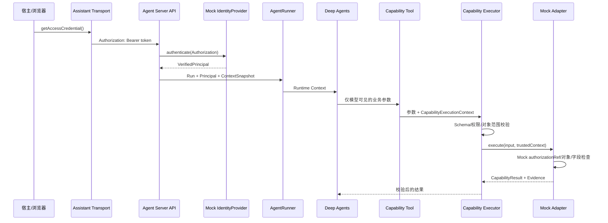

# 外部认证与业务 API 委托调用流程

> 状态：目标设计已明确，当前代码只完成 Mock 身份闭环；企业 Identity Provider、Credential
> Broker 与真实业务 API 委托尚未接入。本文不得作为“生产认证已经完成”的证明。

## 1. 目的与范围

本文说明外部宿主系统的登录身份如何进入 AI 助手服务，如何形成可信执行上下文，以及 Adapter
调用原业务 API 时应如何取得受控凭证并继承原业务权限。

本文覆盖两类不同凭证：

| 凭证 | 用途 | 生命周期 | 是否进入模型上下文 |
| --- | --- | --- | --- |
| Assistant 访问凭证 | 浏览器或宿主访问 Agent Server | 短期，绑定当前用户/宿主 | 否 |
| 业务 API 凭证 | Adapter 代表用户或服务调用原业务系统 | 按调用短期获取 | 否 |

两类凭证不能混为一谈。浏览器能够访问助手，不代表插件自动获得调用任意业务系统的权限。

## 2. 核心安全原则

1. 浏览器只提交认证凭证和页面业务上下文，不能自报用户 ID、租户、权限或角色。
2. Agent Server 必须通过可信 Identity Provider 建立 `VerifiedPrincipal`。
3. 原始长期 Token 不进入 Prompt、Tool 参数、Skill、ContextSnapshot、日志或 Evidence。
4. Deep Agents Runtime Context 只携带可信主体信息和不透明的 `authorizationRef`。
5. Capability Executor 每次 Tool Call 都检查能力权限和对象范围。
6. Adapter 调用业务 API 时使用真实用户委托或受控服务身份；原业务 API 最终执行对象、行列、
   字段权限和脱敏。
7. `authorizationRef` 只是服务端凭证引用，不是业务访问 Token，也不能单独构成授权。

## 3. 当前已经实现的调用链



### 3.1 浏览器发送 Assistant 访问凭证

`AssistantApiTransport` 通过 `getAccessCredential()` 获取凭证，并为 REST 与 SSE 请求添加：

```http
Authorization: Bearer <assistant-access-token>
```

对应实现：`packages/assistant-transport/src/index.ts`。

### 3.2 Agent Server 建立可信主体

API 统一调用：

```ts
identity.authenticate(request.headers.get("authorization"));
```

认证成功后得到：

```ts
interface VerifiedPrincipal {
  id: string;
  displayName: string;
  tenantId: string;
  permissionScopes: readonly string[];
  authorizedObjectIds: readonly string[];
  authorizationRef: string;
}
```

当前 `apps/agent-server/src/modules/identity/identity.ts` 使用 `MockIdentityProvider`，只识别仓库内
预设的 Mock Token。`apps/agent-server/src/composition/create-application.ts` 目前直接实例化该 Mock，
尚未注入真实企业 IdP。

### 3.3 身份进入可信 Runtime Context

`AgentRunner` 从服务端 `VerifiedPrincipal` 构建 Runtime Context：

```ts
{
  principalId,
  tenantId,
  authorizationRef,
  authorizedObjectIds,
  permissionScopes,
  contextSnapshotId,
  sessionId,
  runId,
  traceId
}
```

这些字段不属于模型生成的 Tool 参数。Tool Factory 从 Deep Agents 的 Runtime Context 构造
`CapabilityExecutionContext`，再交给 Capability Executor 和 Provider。

### 3.4 Capability 与 Adapter 再次授权

Capability Executor 先检查 Contract 输入、所需权限和对象范围。通过后才调用 Provider。

当前 Demo Adapter 只执行 Mock 检查：`authorizationRef` 是否与主体对应、对象是否位于
`authorizedObjectIds`、敏感字段权限是否存在。它没有向真实业务 API 发送委托 Token。

## 4. iframe 认证流程

iframe 不能从 URL、`postMessage` 或 HTML 获得长期 Token。目标流程为：

```text
宿主可信登录态
  → POST /api/v1/embed/tickets
  → 服务端签发绑定 targetOrigin 的一次性 Ticket
  → iframe POST /api/v1/embed/exchange
  → 获得短期 Assistant 访问凭证
  → 后续 REST/SSE 使用 Bearer
```

Ticket 必须绑定目标 Origin、短时过期、只能消费一次。当前仓库已实现这条流程的 Mock 版本。

## 5. 生产目标架构

```mermaid
flowchart LR
  Host[宿主登录态/JWT/Session] --> API[Agent Server]
  API --> IDP[Enterprise Identity Provider]
  IDP --> Principal[VerifiedPrincipal]
  Principal --> Runtime[Trusted Runtime Context]
  Runtime --> Executor[Capability Executor]
  Executor --> Adapter[Trusted Adapter]
  Adapter --> Broker[Business Credential Broker]
  Broker --> IdP2[OAuth OBO / STS / Vault]
  IdP2 --> Token[短期业务 API Token]
  Token --> Business[原业务 API]
  Business --> Authz[对象/行列/字段权限与脱敏]
  Authz --> Adapter
```



生产接入需要补齐两个服务端扩展点。

### 5.1 Enterprise Identity Provider

用于验证浏览器或宿主访问助手的凭证：

```ts
interface IdentityProvider {
  authenticate(authorization: string | null): Promise<VerifiedPrincipal>;
}
```

实现可以使用：

- 企业 OIDC/OAuth2 JWT 验签；
- API Gateway 已认证 Header，但必须校验 Header 只可能由可信网关写入；
- 服务端 Session/Cookie，并配套 CSRF 防护；
- Token Introspection 或企业统一身份服务。

`permissionScopes` 与 `authorizedObjectIds` 必须来自可信服务端查询或受验证 Claim，不能从请求体、
页面 Context 或 Prompt 取得。

### 5.2 Business Credential Broker

用于把不透明 `authorizationRef` 兑换为调用某个业务系统的短期凭证：

```ts
interface BusinessCredentialBroker {
  getAccessToken(input: {
    pluginId: string;
    principalId: string;
    tenantId: string;
    authorizationRef: string;
    audience: string;
    traceId: string;
  }): Promise<{
    accessToken: string;
    expiresAt: string;
  }>;
}
```

Broker 可以实现 OAuth 2.0 On-Behalf-Of、Token Exchange、企业 STS，或从服务端安全会话中取得短期
委托凭证。它必须校验插件、租户、主体、目标 audience 和允许的 Scope。

业务 Token 只在 Adapter 到业务 API 的服务端请求期间存在。缓存必须按主体、租户、audience、
scope 隔离，并在过期、撤销或 Session 失效后立即不可用。

## 6. Adapter 调用业务 API 的目标方式

```ts
async function execute(input, context) {
  const credential = await credentialBroker.getAccessToken({
    pluginId: "product-a-adapter",
    principalId: context.principalId,
    tenantId: context.tenantId,
    authorizationRef: context.authorizationRef,
    audience: "product-a-api",
    traceId: context.traceId,
  });

  const response = await businessApi.getObject(input.objectId, {
    authorization: `Bearer ${credential.accessToken}`,
    traceId: context.traceId,
  });

  // 原业务 API 已执行对象、行列和字段授权；Adapter 仍只映射允许进入标准结果的数据。
  return mapAuthorizedResponse(response);
}
```

示例仅表达边界，接口尚未在仓库实现。不要把 `accessToken` 放进 Capability Result、异常消息、日志
metadata 或 Audit Record。

## 7. 服务身份与用户委托的选择

| 模式 | 适用场景 | 权限要求 |
| --- | --- | --- |
| 用户委托 | 查询结果必须严格继承当前用户权限 | 优先选择；原业务 API 能识别用户主体 |
| 受控服务身份 | 后台公共目录、无法委托的旧系统 | 必须在 Adapter/业务 API 显式传递并校验用户范围，服务账号不能默认拥有全量数据 |
| 插件静态 Secret | 调用固定外部服务或签名 | 通过凭证引用获取，不代表当前用户权限 |

Plugin Runtime 已定义 `host.credentials.getSecret(reference)`，但 Agent Server 当前没有向 Plugin
Runtime 注入真实 `getSecret`，而且静态 Secret 接口不能替代按用户委托的 Credential Broker。

## 8. 代码接入点

| 位置 | 当前职责 | 生产改造 |
| --- | --- | --- |
| `packages/assistant-transport/src/index.ts` | 添加 Assistant Bearer | 接入宿主短期凭证获取/刷新 |
| `apps/agent-server/src/http/api.ts` | 调用 Identity Provider | 保持统一认证入口 |
| `apps/agent-server/src/modules/identity/identity.ts` | Mock Token → Principal | 增加企业 IdP 实现，Mock 仅用于测试 |
| `apps/agent-server/src/composition/create-application.ts` | 硬编码 Mock Identity | 改为从 Composition Root 注入接口实现 |
| `apps/agent-server/src/modules/session/runner.ts` | Principal → Runtime Context | 保持只传可信字段和 `authorizationRef` |
| `packages/agent-runtime/src/tools/capability-tool-factory.ts` | Runtime → Capability Context | 禁止把身份字段暴露为 Tool 参数 |
| `core/capability/src/executor/executor.ts` | 权限、Schema 与 Audit | 保持每次 Tool Call 强制执行 |
| `packages/plugin-runtime/src/runtime/host-services.ts` | 静态 Secret 抽象 | 注入真实 Secret Provider；另建用户委托 Broker |
| `adapters/*` | Mock 授权与数据映射 | 调用 Broker 和真实业务 API，保留业务 API 最终授权 |

## 9. 失败处理与审计

| 场景 | 对外结果 | 审计要求 |
| --- | --- | --- |
| Assistant 凭证缺失/失效 | HTTP 401 | 记录安全错误码，不记录 Token |
| 用户没有 Capability 权限 | `FORBIDDEN`/HTTP 403 | 主体、能力、对象、traceId |
| Broker 拒绝兑换 | `FORBIDDEN` 或受控上游错误 | pluginId、audience、主体、拒绝原因码 |
| 业务 API 拒绝对象/字段 | `FORBIDDEN` 或 `partial` | 不记录受限字段值 |
| 业务 Token 过期 | 最多一次受控刷新；失败即终止 | 不无限重试，不降级为高权限服务账号 |
| 业务 API 超时 | `UPSTREAM_TIMEOUT` | 耗时、目标服务标识、traceId |

日志与 Audit 可以记录主体 ID、租户、插件、Capability、对象 ID、`authorizationRef` 的安全句柄和
错误码，但不能记录 Authorization Header、Cookie、Secret、完整业务响应或 PII。

## 10. 实施顺序

1. 让 `createAgentApplication()` 接受注入的 `IdentityProvider`，Mock 作为显式开发配置。
2. 实现目标企业 Identity Provider，并验证 JWT/Session、Issuer、Audience、过期和撤销。
3. 定义并实现 `BusinessCredentialBroker`，选择 OBO/STS/Vault 方案。
4. 为 Plugin/Adapter 提供最小委托访问接口，不向模型和 Skill 暴露 Token。
5. 选择一个只读业务 API 完成真实 Adapter 垂直切片。
6. 接入持久化 Audit、指标与告警，再执行双产品独立部署验收。
7. 真实试点通过前，文档和页面继续明确标记 Mock 边界。

## 11. 必须覆盖的测试

- 缺失、伪造、过期、错误 Issuer/Audience 的 Assistant Token 均返回 401。
- 请求体或页面 Context 伪造 `userId/admin/permissions` 不改变 `VerifiedPrincipal`。
- 用户 A 不能读取用户 B 的 Session、Run、SSE 和 Evidence。
- `authorizationRef` 被篡改、跨租户复用或绑定错误 audience 时 Broker 拒绝。
- Adapter 不能获得未在批准策略中的 Scope 或业务系统 Token。
- 无 Capability 权限、无对象权限和无字段权限分别在对应层失败关闭。
- Token、Cookie、Secret 不出现在 Prompt、Tool 参数、事件、Evidence、日志和 Audit。
- iframe Ticket 的 Origin、一次性消费和过期校验稳定拒绝异常请求。
- Broker/业务 API 超时、撤销和 Token 过期不会降级为高权限身份。
- A/B 实例的 Identity、Broker、Credential Store、Session 和 Checkpointer 完全隔离。

## 12. 当前结论

当前仓库已经实现 Assistant Bearer 入口、Mock Identity、可信 Principal、Runtime Context、Capability
权限和 Adapter 二次检查，但尚未实现企业 IdP、按用户委托的 Credential Broker 或真实业务 API
调用。因此当前状态是“认证与授权链路的可验证 Mock”，不是“生产外部认证已接通”。

相关规范：

- [架构基线与边界](architecture-v2.0/01-架构基线与边界.md)
- [核心领域契约与上下文](architecture-v2.0/04-核心领域契约与上下文.md)
- [安全、权限、证据与审计](architecture-v2.0/08-安全权限证据与审计.md)
- [HTTP API 与事件协议](architecture-v2.0/09-API数据模型与事件协议.md)
- [实施状态](implementation-status.md)
